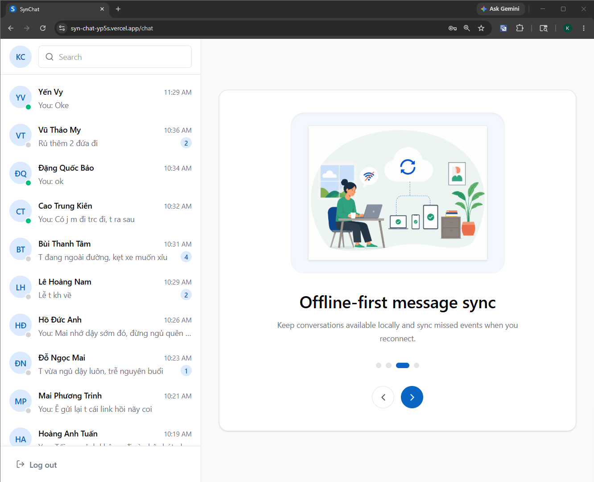
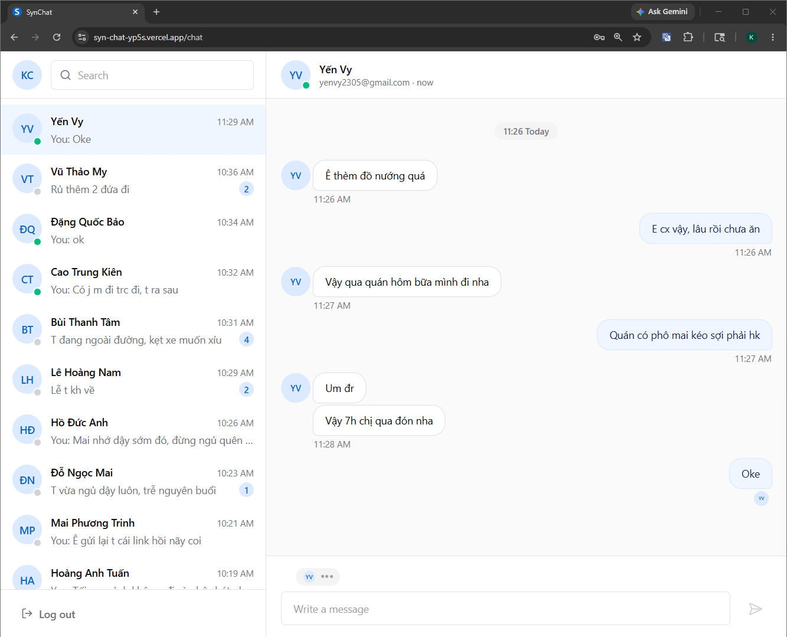

<a id="readme-top"></a>

<br />
<div align="center">
  <a href="https://syn-chat-yp5s.vercel.app">
    
  </a>

  <h1 align="center">SynChat</h1>

  <p align="center">
    <strong>A real-time chat application with browser caching, cross-device data synchronization, and web push notifications.</strong>
    <br />
    <br />
    <a href="#-overview">Overview</a>
    ·
    <a href="#-features">Features</a>
    ·
    <a href="#️-tech-stack">Tech Stack</a>
    ·
    <a href="#-local-development">Local Development</a>
    ·
    <a href="#-future-improvements">Future Improvements</a>
  </p>
</div>

---

## 📖 Overview

**SynChat** is a full-stack chat system designed around realtime messaging and local-first rendering.

The client stores durable chat data in IndexedDB and renders from local data first. The backend remains authoritative for authentication, message ordering, event sequencing, receipts, presence, device state, and push notification delivery.

SynChat is designed for reliable chat synchronization, including instant sending, automatic reconnection, missed message recovery, local message loading, typing indicators, delivery/read status, and background web push notifications.

<div align="center">
  
  
</div>

---

## ✨ Features

- **Realtime message synchronization** — messages appear instantly across active browser sessions.
- **Multi-device conversation synchronization** — the same account stays up to date across different devices or tabs.
- **Offline synchronization recovery** — when a device comes back online, SynChat fetches missed updates and restores the latest chat state.
- **Reliable message sending** — outgoing messages use a client-generated id to avoid duplicates during retry or reconnect.
- **Browser chat cache** — recent conversations and messages are stored locally so the app can open quickly after reload.
- **Read and delivery status synchronization** — message status updates across sessions when messages are delivered or read.
- **Online status synchronization** — online/offline state and last seen information update in realtime.
- **Background notifications** — devices in the background can still receive push notifications for new messages.

---

## 🛠️ Tech Stack

### Frontend

<p align="center">
  <a href="https://react.dev/" target="_blank" rel="noreferrer"></a>
  <a href="https://www.typescriptlang.org/" target="_blank" rel="noreferrer"></a>
  <a href="https://vite.dev/" target="_blank" rel="noreferrer"></a>
  <a href="https://dexie.org/" target="_blank" rel="noreferrer"></a>
  <a href="https://firebase.google.com/" target="_blank" rel="noreferrer"></a>
</p>

### Backend

<p align="center">
  <a href="https://spring.io/projects/spring-boot" target="_blank" rel="noreferrer"></a>
  <a href="https://spring.io/projects/spring-security" target="_blank" rel="noreferrer"></a>
  <a href="https://www.postgresql.org/" target="_blank" rel="noreferrer"></a>
  <a href="https://redis.io/" target="_blank" rel="noreferrer"></a>
  <a href="https://firebase.google.com/docs/cloud-messaging" target="_blank" rel="noreferrer"></a>
</p>

### Infrastructure

<p align="center">
  <a href="https://www.docker.com/" target="_blank" rel="noreferrer"></a>
  <a href="https://flywaydb.org/" target="_blank" rel="noreferrer"></a>
</p>

---

## 🚀 Local Development

### Prerequisites

Install:

- Java
- Node.js
- Docker Desktop
- Firebase project

### Clone Repository

```bash
git clone https://github.com/Cao-Trong-Khang/SynChat.git
cd synchat
```

### Start PostgreSQL and Redis

```bash
docker compose up -d
```

### Backend

Create the backend environment file and update it with your local database, Redis, JWT, and FCM settings.

```powershell
cd backend
cp .env.example .env
```

Create a local run script from the example file, then update the environment variables inside `run-dev.ps1`.

```powershell
cp run-dev.example.ps1 run-dev.ps1
```

Run the backend:

```powershell
.\run-dev.ps1
```

### Frontend

Create the frontend environment file and update it with your API, WebSocket, and Firebase Web Push settings.

```powershell
cd frontend
cp .env.example .env.local
```

Install dependencies and start the frontend:

```powershell
npm install
npm run dev
```

The app will run at:

```text
http://localhost:5173
```

---

## 🔮 Future Improvements

- Mobile support
- Desktop support
- Group conversations
- Message attachments
- Message reactions
- User profile settings
- Friends system

---

<div align="center">
  <p>⭐ Star this repo if you find SynChat helpful! ⭐</p>
  <a href="#readme-top">Back to Top ↑</a>
</div>
