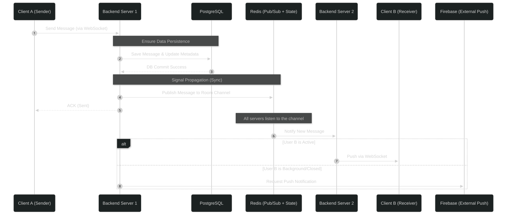
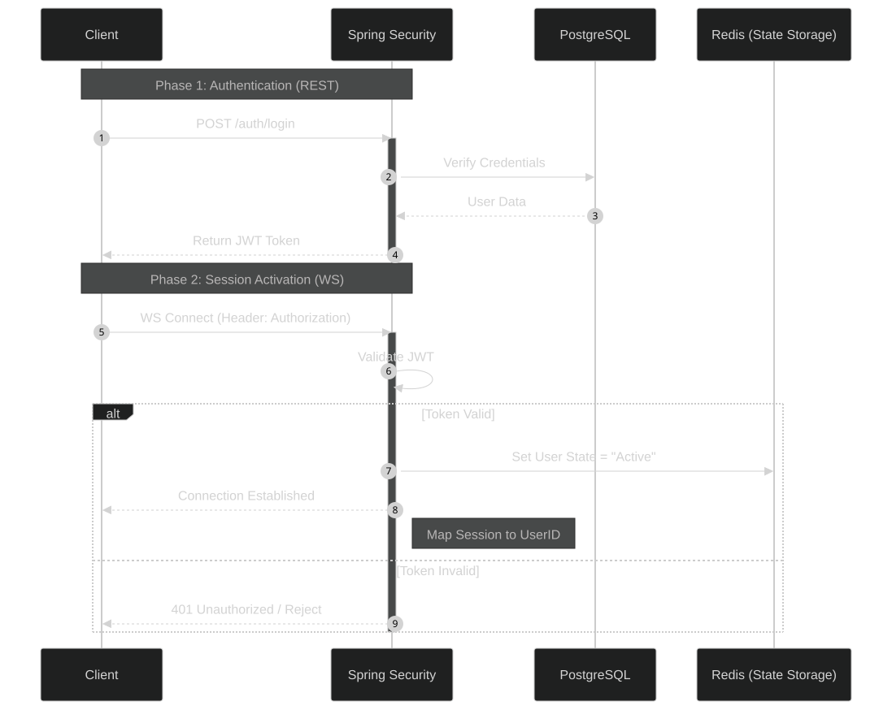

# SynChat - System Architecture Design

## 1. High-level Architecture
The system follows a layered Client-Server architecture, optimized for real-time communication and horizontal scalability.

  
  
<em>High Level Architecture</em>

The system is organized into five main layers:

* **Client Layer:** Includes Mobile, Web, and Desktop applications. All clients communicate with the backend through REST APIs and WebSocket connections.
* **Gateway Layer:** Nginx acts as the single entry point, handling request routing and load balancing across backend instances.
* **Backend Cluster:** Multiple Spring Boot instances handle business logic, real-time messaging, and API processing. This layer is horizontally scalable.
* **Data Layer:**

  * PostgreSQL stores persistent data (users, messages, chat rooms, ...).
  * Redis is used for caching and Pub/Sub to synchronize messages across instances.
* **External Services:**
  * Firebase Cloud Messaging is used to deliver push notifications when users are not actively connected via WebSocket.
  * Cloudinary is a media storage and image CDN used to store, transform, and optimize media assets, ensuring fast delivery and reducing file-processing load on the backend.

Data flows from clients → gateway → backend → data layer, while Redis and FCM support real-time delivery and asynchronous notifications across the system.

## 2. Message Flow Diagram

  
  
<em>Message Flow Diagram</em>

**Detailed description:**

1. **Client A** sends a message through a WebSocket connection (STOMP protocol).
2. **Server 1** receives the message, validates User A’s permission, and checks message validity in the chat room.
3. **Sequential processing to ensure consistency:**

   * **Step 1 - Persistence:** Save the message to PostgreSQL and update **Conversation Metadata** (such as last message and timestamp). DB success is required before moving on.
   * **Step 2 - Global Sync:** Only after the DB commit succeeds, Server 1 publishes the message to a Redis channel to sync across the cluster.
4. **Server 1** sends an **ACK** back to Client A to confirm the message is safely processed.
5. **Delivery Strategy:** The system checks User B’s session state in Redis:

   * **Active App:** If an active WebSocket connection exists (on Server 2 or any instance), the message is pushed directly via WebSocket.
   * **Background/Closed App:** If no active connection is found, the system calls **FCM (Firebase)** to send a push notification.

## 3. Message Delivery Semantics

The system uses **At-least-once delivery** to balance performance and reliability.

* **Sender side:** Uses timeout/retry based on ACK from the server.
* **Receiver side:** If network issues happen while active, the server does not retry via socket to avoid congestion. When the client reconnects, it fetches new messages from PostgreSQL based on the last received message ID.
* **Data safety:** PostgreSQL is the "Source of Truth". Even if Redis fails, messages are still safe and can be reloaded.

## 4. Auth Flow (JWT & State Management)

  
  
<em>Auth Flow Diagram</em>

**Detailed description:**

1. **Authentication (REST - Stateless):**

   * Client sends a login request via REST API.
   * Server verifies user credentials with PostgreSQL.
   * If valid, the server returns a JWT token.
   * JWT is used for future requests without storing session on the server.

2. **Session Activation (WebSocket):**

   * Client opens a WebSocket connection with JWT in the `Authorization` header.
   * Server validates the JWT during handshake.
   * If valid, the WebSocket connection is established and linked to `user_id`.

3. **Presence Registration (Redis):**

   * After connection is established, the server stores user state in Redis:

     * `user_id -> server_id`
   * This is used to locate the user connection in the cluster and route messages correctly.

4. **Connection Lifecycle & Cleanup:**

   * When the WebSocket connection is closed (app closed or network lost), the server removes the mapping from Redis.
   * If no mapping exists, the user is considered not active.

## 5. Caching & Messaging Strategy

We choose **Redis Pub/Sub** instead of heavier message brokers (Kafka/RabbitMQ):

* **Latency:** Micro-second level response, suitable for chat systems.
* **Role:** Redis acts as a fast signal channel between instances. PostgreSQL remains the main data store.
* **Trade-off:** Accept the "fire-and-forget" nature of Redis Pub/Sub because missed messages can be recovered from DB when reconnecting.

## 6. DB Schema & Indexing Strategy

* **B-Tree Index:** Used on `user_id`, `chat_room_id`, and `created_at` for efficient pagination.
* **GIN Index:** Use `pg_trgm` for fast fuzzy search (e.g., partial or accent-insensitive search on `display_name`).
* **Denormalization:** Store metadata (e.g., `last_message_at`) directly in `chat_rooms` to avoid complex queries.

## 7. Horizontal Scaling Concept

* **Nginx:** Acts as a load balancer to distribute traffic across backend instances.
* **Stateless Backend:** Servers do not store local sessions. Users can connect to any instance using JWT and Redis state.
* **Inter-server Communication:** Redis Pub/Sub ensures users on different servers can still receive messages instantly.