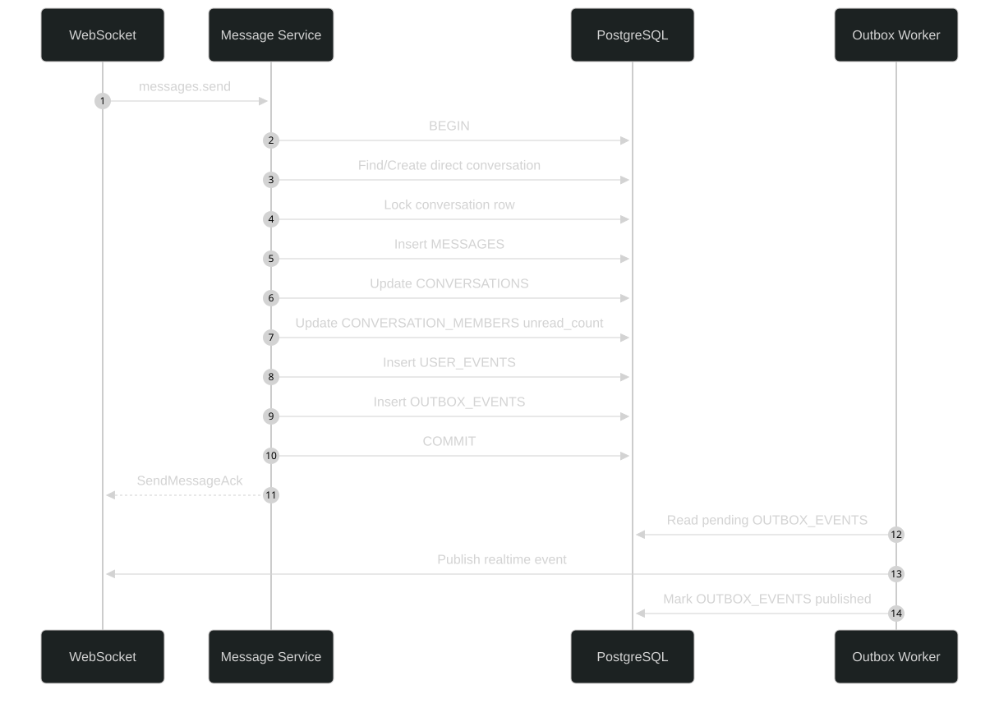

# SynChat Architecture

## Table of Contents

1. [Overview](#1-overview)
2. [High-Level Architecture](#2-high-level-architecture)
3. [Client Architecture](#3-client-architecture)
4. [Backend Architecture](#4-backend-architecture)
5. [Data Ownership](#5-data-ownership)
6. [Communication Pattern](#6-communication-pattern)
7. [Sync Model](#7-sync-model)
8. [Realtime Model](#8-realtime-model)
9. [Message Send Transaction](#9-message-send-transaction)
10. [Presence, Typing, and Push](#10-presence-typing-and-push)
11. [Backend Package Structure](#11-backend-package-structure)
12. [Architecture Rules](#12-architecture-rules)

---

## 1. Overview

SynChat is a realtime 1:1 chat system with local-first clients.

The client reads data from local DB first. The server is still the source of truth for message order, message sequence, receipts, unread state, and sync events.

Main goals:

- Realtime chat.
- Offline cache.
- Multi-device consistency.
- Paginated sync, not full sync.
- Push notification for background or offline devices.

---

## 2. High-Level Architecture


### Component Responsibilities

#### Client Apps

The client can run on Web, Android, and later Desktop.

- **UI Layer**: renders the conversation list, chat detail, typing indicator, online status, and message status.
- **Repository Layer**: provides a clean API for the UI to read and write local data.
- **Local DB**: stores cached users, conversations, messages, message sync state, sync cursors, and local outbox commands.
- **Sync Engine**: handles bootstrap sync, event sync, conversation pagination, and message pagination.
- **Realtime Engine**: manages the WebSocket connection, receives realtime events, sends commands, and handles reconnect.
- **Local Outbox Worker**: retries local commands when the client was offline or the socket was unavailable.
- **Presence / Typing Store**: keeps temporary UI state in memory, such as online users and typing state. This data is not stored in the local DB.

#### Spring Boot Backend

The backend is a modular monolith. Each module has a clear responsibility.

- **Auth**: authenticates REST and WebSocket requests.
- **User**: handles user search and user profile data.
- **Conversation**: manages direct conversations and conversation metadata.
- **Message**: handles message sending, message persistence, and message ordering.
- **Receipt**: handles delivered and read receipts.
- **Sync**: provides APIs for bootstrap sync, event sync, conversation pagination, and message pagination.
- **WebSocket Gateway**: receives realtime commands and sends realtime events to connected clients.
- **Device**: stores device information and push tokens.
- **Presence / Typing**: manages temporary online, presence subscription, and typing state in Redis.
- **Outbox Worker**: reads pending `OUTBOX_EVENTS` and publishes realtime events after database commits.
- **Notification**: sends push notifications to Android and Web devices when needed.

#### Infrastructure

- **PostgreSQL**: the source of truth for users, conversations, messages, receipts, devices, user events, and outbox events.
- **Redis**: stores temporary realtime state such as online devices, presence subscriptions, typing subscriptions, and device foreground/background state.
- **FCM / Web Push**:
  - **FCM** is used for Android push notifications.
  - **Web Push** is used for browser notifications.

---

## 3. Client Architecture

The client has four important parts:

- UI Layer
- Repository Layer
- Local DB
- Sync / Realtime / Outbox Engines

The UI should not render directly from network responses. All durable chat data should go through local DB first.

```text
Network response / WebSocket event
        ↓
Upsert local DB
        ↓
UI observes local DB
        ↓
Render
```

Client local DB tables:

```text
LOCAL_USERS
LOCAL_CONVERSATIONS
LOCAL_MESSAGES
LOCAL_MESSAGE_SYNC_STATE
LOCAL_SYNC_STATE
LOCAL_OUTBOX_COMMANDS
```

Temporary UI state should stay in memory:

```text
presenceStore
typingStore
```

Presence and typing should not be saved into local DB.

---

## 4. Backend Architecture

The backend should be a modular monolith.

Important modules:

| Module            | Responsibility                                                                                                                         |
| ----------------- | -------------------------------------------------------------------------------------------------------------------------------------- |
| Auth              | Register users, verify credentials, issue access tokens, manage refresh sessions per device, and authenticate REST/WebSocket requests. |
| User              | Search users by email or display name.                                                                                                 |
| Conversation      | Find/create direct conversations and load conversation metadata.                                                                       |
| Message           | Persist messages and create message events.                                                                                            |
| Receipt           | Handle delivered and read receipts.                                                                                                    |
| Sync              | Bootstrap conversations, load messages, and replay user events.                                                                        |
| WebSocket Gateway | Receive realtime commands and deliver realtime events.                                                                                 |
| Device            | Register device and push token.                                                                                                        |
| Presence / Typing | Store temporary realtime state in Redis.                                                                                               |
| Outbox Worker     | Publish pending outbox events.                                                                                                         |
| Notification      | Send push notifications to background/offline devices.                                                                                 |

---

## 5. Data Ownership

PostgreSQL is the source of truth.

Server tables:

```text
USERS
DEVICES
USER_CREDENTIALS
AUTH_SESSIONS
CONVERSATIONS
CONVERSATION_MEMBERS
MESSAGES
USER_EVENT_OFFSETS
USER_EVENTS
OUTBOX_EVENTS
```

Redis stores temporary realtime state:

```text
presence
presence subscriptions
typing subscriptions
typing TTL
device foreground/background state
websocket sessions
```

Local DB is only a cache plus local command queue. It does not need to mirror the server DB.

---

## 6. Communication Pattern

The system uses both REST and WebSocket.

REST is used for:

- Register.
- Login.
- Refresh session.
- Logout.
- Bootstrap sync.
- Pagination.
- Event recovery.
- User search.

WebSocket is used for:

- Sending realtime commands.
- Receiving realtime events.
- Delivered and read receipts.
- Presence and typing.
- Device registration.

Simple rule:

```text
REST = sync, recovery, and pagination
WebSocket = realtime commands and realtime events
```

For detailed endpoint and WebSocket message contracts, see [API.md](API.md).

---

## 7. Sync Model

The system uses three sync types.

### 7.1 Conversation Page Sync

Conversation page sync loads conversation metadata by page.

Used when:

- The user opens the app on a new platform.
- The user scrolls down the conversation list.
- The event cursor is expired and the client resets cache.

The first request has no cursor because the client has no local conversation cursor yet. Later requests use the saved conversation cursor from `LOCAL_SYNC_STATE`.

This sync returns conversation metadata only. It does not return full message history.

### 7.2 Message Page Sync

Message page sync loads messages of one conversation by page.

Used when:

- The user opens a conversation that has no local messages yet.
- The user scrolls up to load older messages.

The first message load gets the latest messages. Older messages are loaded using `LOCAL_MESSAGE_SYNC_STATE.oldest_loaded_seq`.

### 7.3 Event Sync

Event sync replays missed domain events.

Used when:

- The app reopens after offline time.
- WebSocket reconnects.
- The client detects an event sequence gap.

The client stores the last applied event sequence in `LOCAL_SYNC_STATE`.

If the server can no longer replay events from that sequence, the client resets cache and runs conversation bootstrap again.

---

## 8. Realtime Model

Realtime events are delivered through WebSocket.

Persisted domain events are saved in `USER_EVENTS` so clients can replay missed events.

Important persisted domain events:

```text
MessageCreated
MessageDelivered
MessageRead
```

Temporary WebSocket commands are not saved in `USER_EVENTS`.

Examples:

```text
typing.start
typing.stop
typing.subscribe
typing.unsubscribe
presence.subscribe
presence.unsubscribe
device.state
```

Client must validate `event_seq` before applying events.

Rules:

```text
event_seq <= last_handled_event_seq
→ ignore duplicate or old event

event_seq == last_handled_event_seq + 1
→ apply event and update checkpoint

event_seq > last_handled_event_seq + 1
→ stop and run event sync
```

Realtime delivery is at-least-once. The client must be idempotent.

Useful idempotency keys:

```text
event_seq
conversation_local_id + seq
client_message_id
```

---

## 9. Message Send Transaction

Message send is the most important write transaction.



Important rules:

- Never publish realtime event before DB commit.
- Insert `MESSAGES`, `USER_EVENTS`, and `OUTBOX_EVENTS` in the same transaction.
- Message retry must reuse the same `client_message_id`.
- The server must deduplicate using `sender_id + client_message_id`.

---

## 10. Presence, Typing, and Push

### Presence

Presence is temporary.

Current online state is stored in Redis. Durable last seen time is stored in:

```text
USERS.last_seen_at
```

The client subscribes to presence only for visible users:

- Peers in the loaded conversation list.
- The peer in the opened chat detail.

The UI uses:

```text
LOCAL_USERS → avatar, display name, email
presenceStore → online dot and last seen text
```

### Typing

Typing is also temporary.

Typing state is stored in Redis with a short TTL:

```text
typing:{conversationId}:{userId}
```

### Push

Push notification is decided per device.

Rule:

```text
Online WebSocket device
→ receive realtime event

Background/offline device
→ can receive push notification
```

Another online device does not prevent push for a background/offline device of the same user.

---

## 11. Backend Package Structure

Spring Boot package structure:

```text
backend/src/main/java/com/synchat/backend
├── auth
├── user
├── device
├── conversation
├── message
├── receipt
├── sync
├── realtime
│   ├── websocket
│   ├── presence
│   └── typing
├── notification
├── outbox
├── common
│   ├── config
│   ├── exception
│   ├── security
│   └── util
└── BackendApplication.java
```

Each module can use this shape:

```text
module
├── controller / ws
├── service
├── repository
├── entity
├── dto
└── mapper
```

---

## 12. Architecture Rules

1. UI reads from local DB or in-memory realtime stores.
2. Server is authoritative for message order, `seq`, `read_seq`, `delivered_seq`, and `unread_count`.
3. Client timestamp is not used for message ordering.
4. WebSocket is not the source of truth. REST sync can recover missed events.
5. Message retry must reuse the same `client_message_id`.
6. `USER_EVENTS` is for replayable domain events.
7. Typing, presence, and subscriptions are ephemeral and stored in Redis or memory.
8. `OUTBOX_EVENTS` must be inserted in the same transaction as the business write.
9. Conversation list pagination must use keyset cursor, not offset.
10. Local DB does not need to mirror server DB.
11. Login creates a session for the current device only.
12. Logout revokes only the current device session and clears local chat cache on that device.
