# SynChat Database Design

## Table of Contents

1. [Overview](#1-overview)
2. [Server Database](#2-server-database)
3. [Server Table Responsibilities](#3-server-table-responsibilities)
4. [Server Constraints and Indexes](#4-server-constraints-and-indexes)
5. [Client Local Database](#5-client-local-database)
6. [Client Table Responsibilities](#6-client-table-responsibilities)

---

## 1. Overview

SynChat uses two database layers:

```text
Server PostgreSQL
→ source of truth
→ users, auth sessions, conversations, messages, receipts, user events, outbox events

Client Local DB
→ local cache and local command queue
→ users, conversations, messages, sync state, pending local commands
```

The client database does not need to mirror the server database. It only stores the data needed for offline reading, fast rendering, and sync recovery.

Temporary realtime state is not stored in either database:

```text
Presence → Redis + client memory
Typing   → Redis + client memory
Device foreground/background state → Redis
```

---

## 2. Server Database



---

## 3. Server Table Responsibilities

| Table                  | Responsibility                                                                       |
| ---------------------- | ------------------------------------------------------------------------------------ |
| `USERS`                | Stores user profile data and durable `last_seen_at`.                                 |
| `USER_CREDENTIALS`     | Stores password hash for email/password login. Plain password is never stored.       |
| `DEVICES`              | Stores device id, platform, push token, and push provider.                           |
| `AUTH_SESSIONS`        | Stores refresh sessions per device. Logout revokes only the current device session.  |
| `CONVERSATIONS`        | Stores direct conversation metadata and latest message pointer.                      |
| `CONVERSATION_MEMBERS` | Stores per-user conversation state: `read_seq`, `delivered_seq`, and `unread_count`. |
| `MESSAGES`             | Stores server-ordered messages. `seq` is assigned by the server per conversation.    |
| `USER_EVENT_OFFSETS`   | Stores the latest event sequence per user. Used to allocate ordered user events.     |
| `USER_EVENTS`          | Stores replayable domain events for offline sync and WebSocket recovery.             |
| `OUTBOX_EVENTS`        | Stores pending events to publish after the business transaction commits.             |

---

## 4. Server Constraints and Indexes

Important constraints:

```text
USERS.email is unique.
CONVERSATIONS.direct_key is unique.
CONVERSATION_MEMBERS primary key is (conversation_id, user_id).
USER_EVENTS primary key is (user_id, event_seq).
USER_EVENT_OFFSETS has one row per user.
```

Recommended indexes:

```text
DEVICES(user_id)
AUTH_SESSIONS(user_id)
AUTH_SESSIONS(device_id)
CONVERSATION_MEMBERS(user_id)
MESSAGES(conversation_id, seq)
USER_EVENTS(user_id, event_seq)
OUTBOX_EVENTS(status, created_at)
```

Recommended unique constraints:

```text
MESSAGES(conversation_id, seq)
MESSAGES(sender_id, client_message_id)
```

`MESSAGES(sender_id, client_message_id)` is used for idempotent retry. If the same message command is retried with the same `client_message_id`, the server must not insert a duplicate.

`USER_EVENT_OFFSETS.last_event_seq` must be updated atomically. The server should lock the user's offset row or use an atomic update before inserting rows into `USER_EVENTS`.

---

## 5. Client Local Database



---

## 6. Client Table Responsibilities

| Table                      | Responsibility                                                                                                        |
| -------------------------- | --------------------------------------------------------------------------------------------------------------------- |
| `LOCAL_USERS`              | Caches user profile data needed by conversation list, chat detail, and search results.                                |
| `LOCAL_CONVERSATIONS`      | Renders conversation list and stores local metadata for each loaded or pending conversation.                          |
| `LOCAL_MESSAGES`           | Stores loaded, sending, sent, and failed messages.                                                                    |
| `LOCAL_MESSAGE_SYNC_STATE` | Tracks loaded message range for one local conversation.                                                               |
| `LOCAL_SYNC_STATE`         | Stores global sync values such as `last_handled_event_seq`, `next_conversation_cursor`, and `has_more_conversations`. |
| `LOCAL_OUTBOX_COMMANDS`    | Stores retryable local commands when the client is offline or WebSocket is unavailable.                               |

Auth tokens and `deviceId` should be stored in secure storage, not in the chat local database.

Presence and typing should be stored in memory, not in the local database.
