# SynChat Flows

## Table of Contents

1. [Register](#1-register)
2. [Login](#2-login)
3. [Refresh Session](#3-refresh-session)
4. [Logout](#4-logout)
5. [First App Open on a New Platform](#5-first-app-open-on-a-new-platform)
6. [App Reopens After Offline Time](#6-app-reopens-after-offline-time)
7. [Load More Conversations](#7-load-more-conversations)
8. [Search User and Open Virtual Conversation](#8-search-user-and-open-virtual-conversation)
9. [Open Conversation Detail](#9-open-conversation-detail)
10. [Load Older Messages](#10-load-older-messages)
11. [Send Message](#11-send-message)
12. [Delivered Receipt](#12-delivered-receipt)
13. [Read Receipt and Multi-Device Consistency](#13-read-receipt-and-multi-device-consistency)
14. [Push Notification for Offline or Background Recipient](#14-push-notification-for-offline-or-background-recipient)
15. [WebSocket Event Gap Handling](#15-websocket-event-gap-handling)
16. [Send Failure and Retry](#16-send-failure-and-retry)
17. [Device Registration / Push Token Refresh](#17-device-registration--push-token-refresh)
18. [Presence and Last Seen](#18-presence-and-last-seen)
19. [Typing Indicator](#19-typing-indicator)

---

## 1. Register

### Diagram

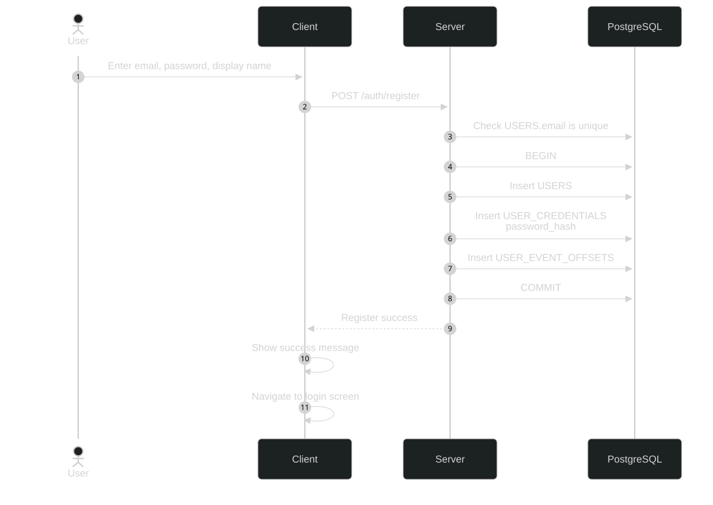

### Description

- This flow runs when a new user creates an account.

- The client sends email, password, and display name to the server.

- The server validates the input, checks that the email is unique, creates the user profile in `USERS`, stores the password hash in `USER_CREDENTIALS`, and initializes the user's event stream in `USER_EVENT_OFFSETS`.

- Registration does not create an authenticated session. The server does not return access token or refresh token.

- After registration succeeds, the client shows a success message and navigates back to the login screen.

---

## 2. Login

### Diagram

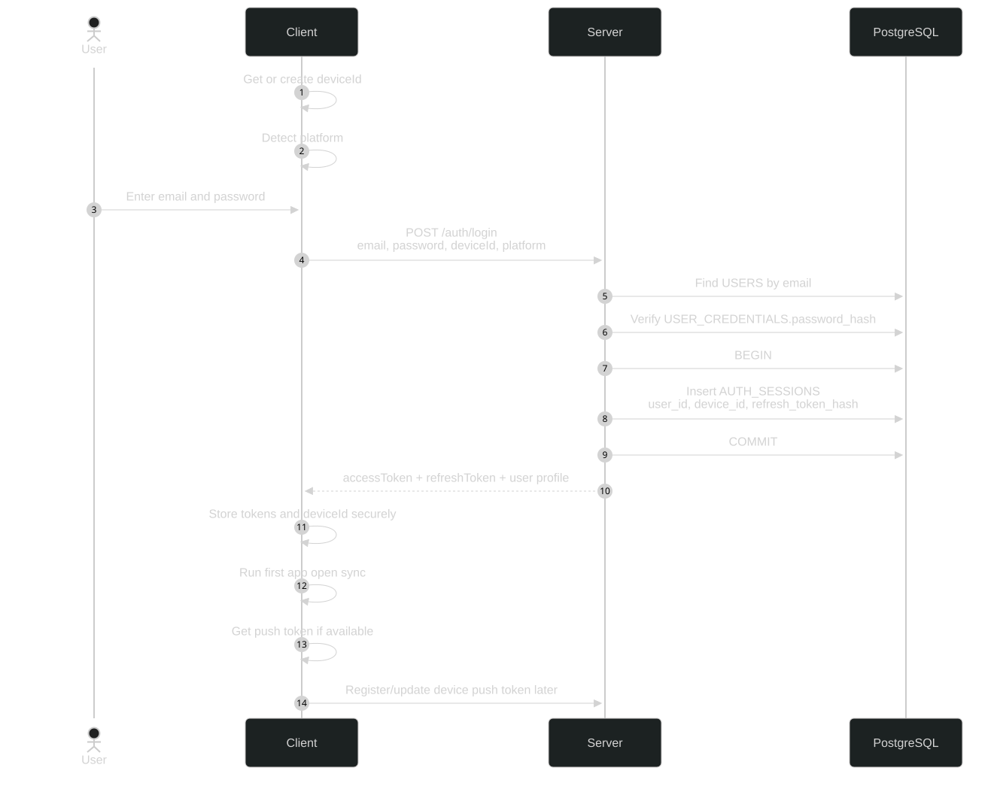

### Description

- This flow runs when an existing user signs in.

- The user only enters email and password. The client creates or reads `deviceId` from local secure storage and detects `platform` from the current app environment.

- The server verifies the credentials and creates a new `AUTH_SESSIONS` row for the current device. This does not affect other devices of the same user.

- The login request does not require `push_token` or `push_provider`. Push token registration is handled by the Device Registration / Push Token Refresh flow after login, because the push token may not be available immediately.

- After login, the client stores tokens securely and runs first app open sync. Because logout clears local chat cache, the local chat database is expected to be empty after a normal login.

---

## 3. Refresh Session

### Diagram

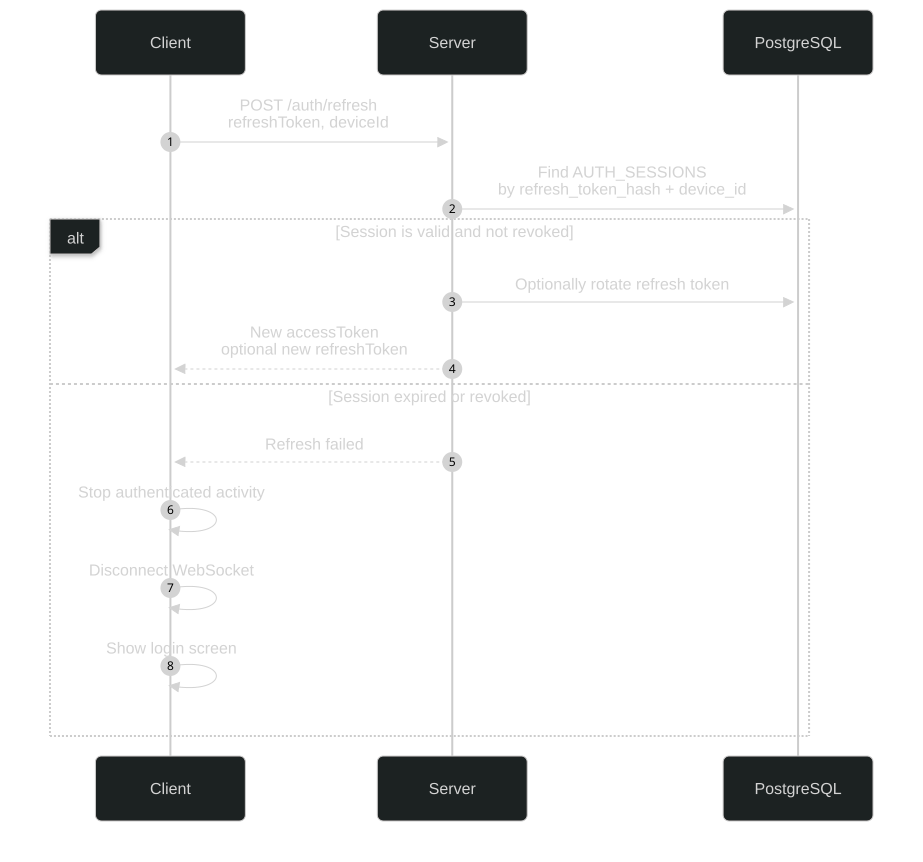

### Description

- This flow runs when the access token is expired but the user still has a valid refresh session.

- The client asks the Auth module for a new access token. If the refresh session is valid, the server returns a new access token.

- If refresh fails, the client should return to the login screen and stop authenticated sync or WebSocket activity.

---

## 4. Logout

### Diagram

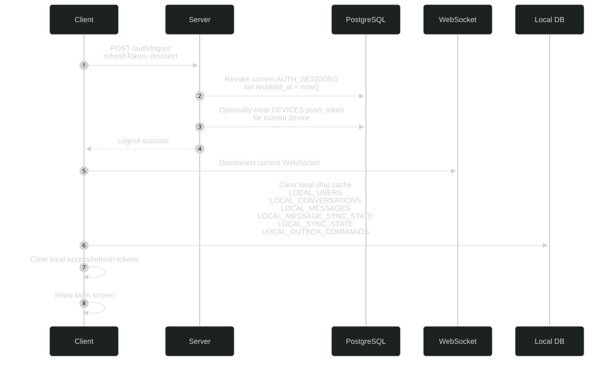

### Description

- This flow runs when the user signs out from the app.

- The client asks the server to revoke the current session or device session. The client then disconnects WebSocket and stops local outbox processing.

- On logout, the client clears local cache to prevent another user on the same device from reading cached messages.

- The client removes local chat data, sync state, and pending local commands. After the same user logs in again, the app will bootstrap sync from the server.

---

## 5. First App Open on a New Platform

### Diagram

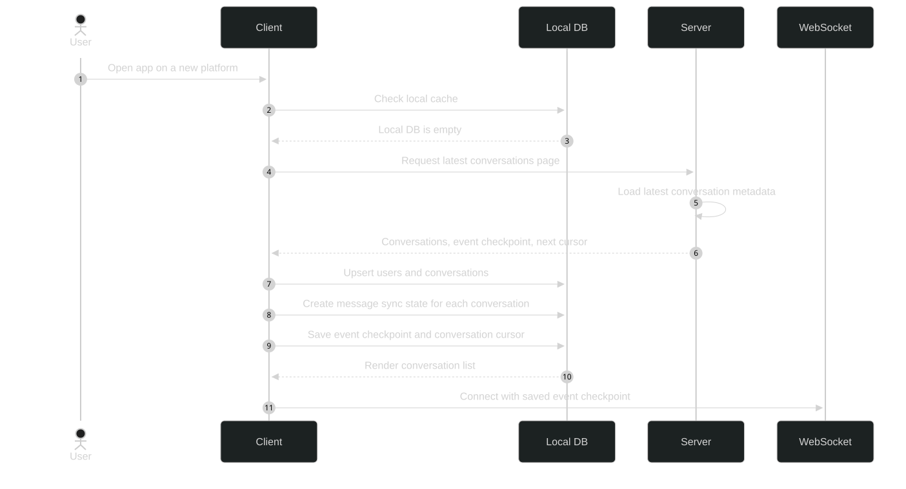

### Description

- This flow runs when the user opens the app on a platform that has no local data yet. The client does not download all old data. It only asks the server for the latest conversation metadata page, for example 20 conversations.

- The server returns conversation metadata, a `serverEventSeq`, a `nextCursor`, and a `hasMore` flag. The client stores them in `LOCAL_USERS`, `LOCAL_CONVERSATIONS`, `LOCAL_MESSAGE_SYNC_STATE`, and `LOCAL_SYNC_STATE`.

- Messages are not loaded yet. They are loaded later when the user opens a conversation.

---

## 6. App Reopens After Offline Time

### Diagram

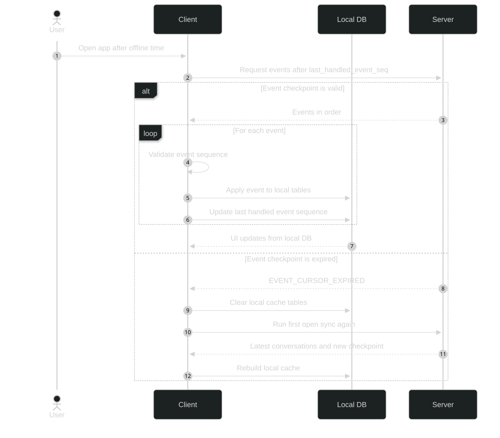

### Description

- This flow is used when the client already has local data but may have missed events while offline.

- The client sends `last_handled_event_seq` from `LOCAL_SYNC_STATE`. If the server still has the events, it returns them sorted by `event_seq`. The client applies each event in order and updates the local checkpoint only after the event is saved locally.

- If the event checkpoint is too old, the server returns `EVENT_CURSOR_EXPIRED`. The client clears cache tables and starts again with the first open sync.

---

## 7. Load More Conversations

### Diagram

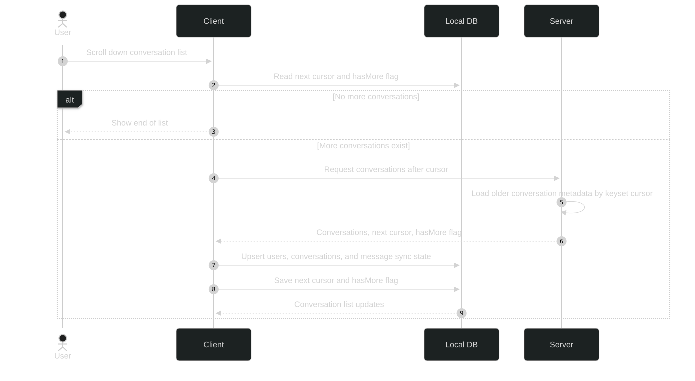

### Description

- This flow loads older conversations when the user scrolls down the conversation list.

- The client uses `next_conversation_cursor` and `has_more_conversations` from `LOCAL_SYNC_STATE`. The server uses keyset pagination, not offset pagination, because conversations can move to the top when new messages arrive.

- The response updates `LOCAL_USERS`, `LOCAL_CONVERSATIONS`, and `LOCAL_SYNC_STATE`. For `LOCAL_MESSAGE_SYNC_STATE`, the client only creates it if it does not exist yet, and must not reset an existing message range.

---

## 8. Search User and Open Virtual Conversation

### Diagram

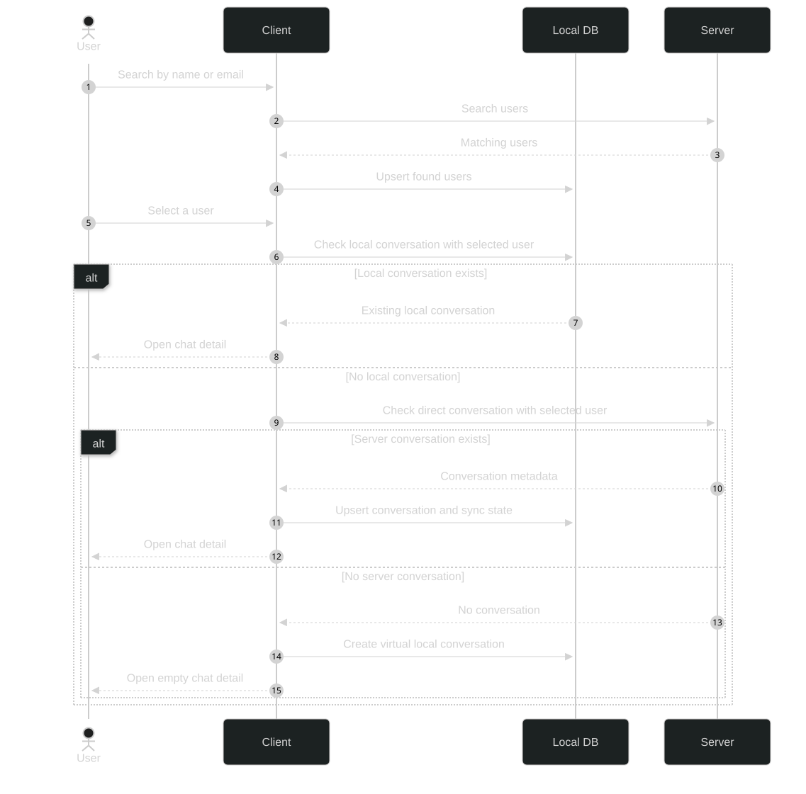

### Description

- The app has no friend system, so search can return users from the database.

- If the selected user already has a conversation, the client opens it. If not, the client creates a virtual local conversation with `LOCAL_CONVERSATIONS.server_id = null`. The server conversation is created only when the first message is sent.

---

## 9. Open Conversation Detail

### Diagram

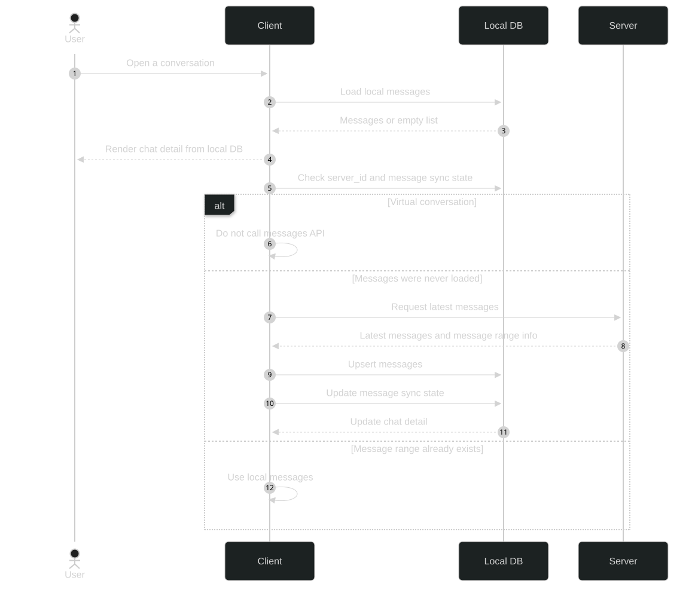

### Description

- The UI always renders from the local database first.

- If the conversation has `server_id = null`, it is virtual, so there is no server message history to load. If `LOCAL_MESSAGE_SYNC_STATE.newest_loaded_seq` is null, the client loads the latest messages from the server and updates the message range.

---

## 10. Load Older Messages

### Diagram

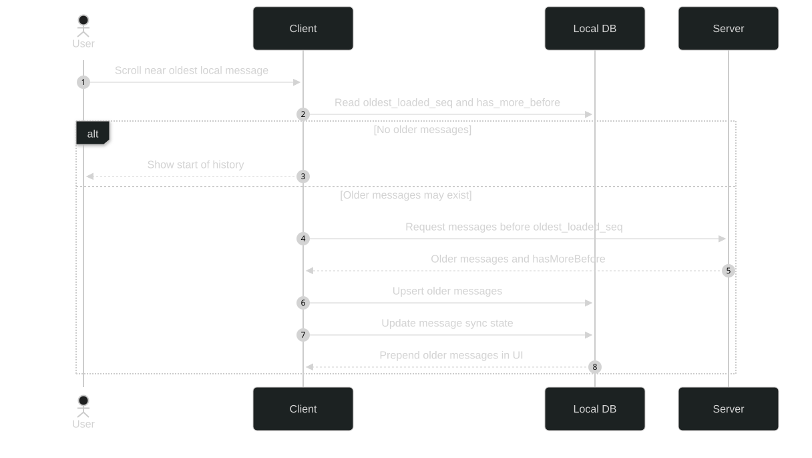

### Description

- This flow loads old messages only when needed. This flow only runs when `oldest_loaded_seq` is not null. If it is null, the client must load the latest messages first in the Open Conversation Detail flow.

- The client uses `LOCAL_MESSAGE_SYNC_STATE.oldest_loaded_seq` as `beforeSeq`. If `has_more_before` is false, the client does not call the server again.

---

## 11. Send Message

### Diagram

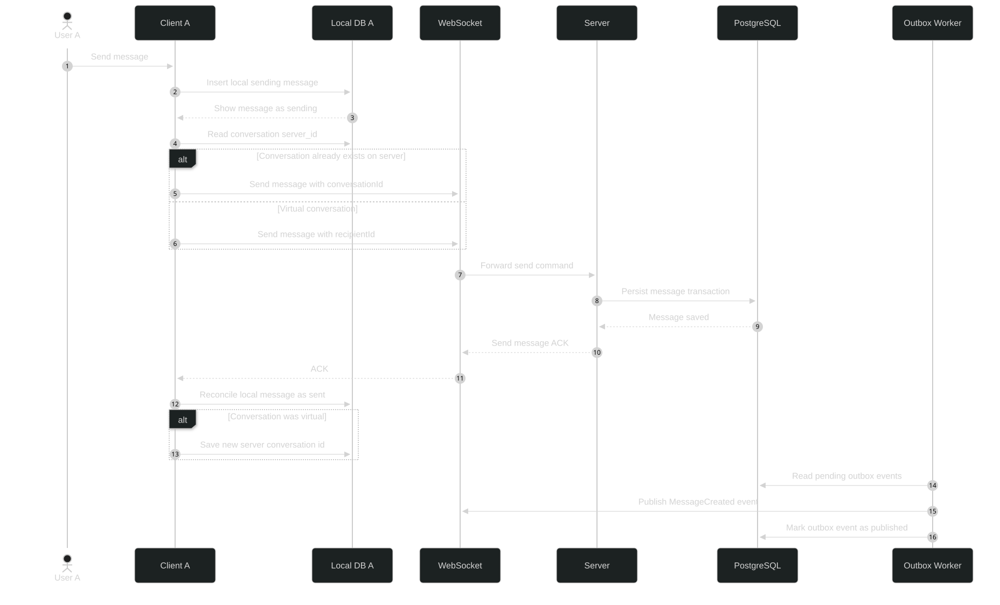

### Description

- The client first inserts a local message with `local_status = sending`. This gives instant UI feedback.

- If the conversation already exists, the client sends `conversationId`. If it is virtual, the client sends `recipientId`. The server creates or finds the direct conversation, inserts the message into `MESSAGES`, updates `CONVERSATIONS`, updates `CONVERSATION_MEMBERS`, inserts `USER_EVENTS`, and inserts `OUTBOX_EVENTS`.

- The ACK contains the server conversation id, message sequence, server time, and `client_message_id`. If the ACK is lost and the client retries with the same `client_message_id`, the server must return the existing message instead of inserting a duplicate.

---

## 12. Delivered Receipt

### Diagram

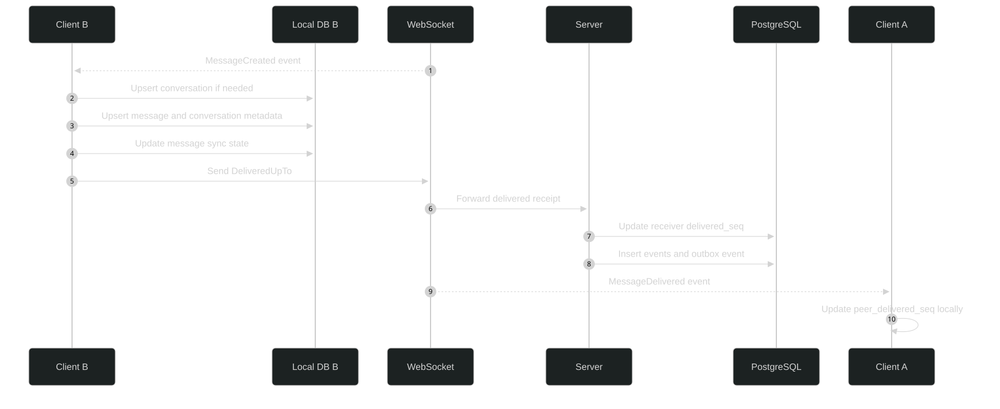

### Description

- Delivered means that at least one recipient device received and saved the message locally.

- If the conversation is not cached yet, Client B creates the local conversation and its message sync state from the `MessageCreated` event before saving the message.

- After Client B saves the message, it sends `DeliveredUpTo` with `delivered_seq`. The server updates `CONVERSATION_MEMBERS.delivered_seq` for User B and emits an event so User A can update `LOCAL_CONVERSATIONS.peer_delivered_seq`.

---

## 13. Read Receipt and Multi-Device Consistency

### Diagram

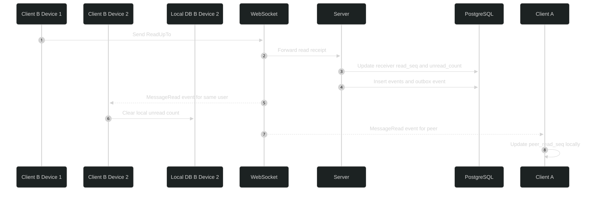

### Description

- Read means the user actually viewed the conversation in foreground.

- The server updates `CONVERSATION_MEMBERS.read_seq` and sets `unread_count = 0` for the reader. The read event is sent to all devices of the same user, so all devices clear unread state. It is also sent to the peer, so the peer can show `seen` when `peer_read_seq` reaches the sent message sequence.

---

## 14. Push Notification for Offline or Background Recipient

### Diagram

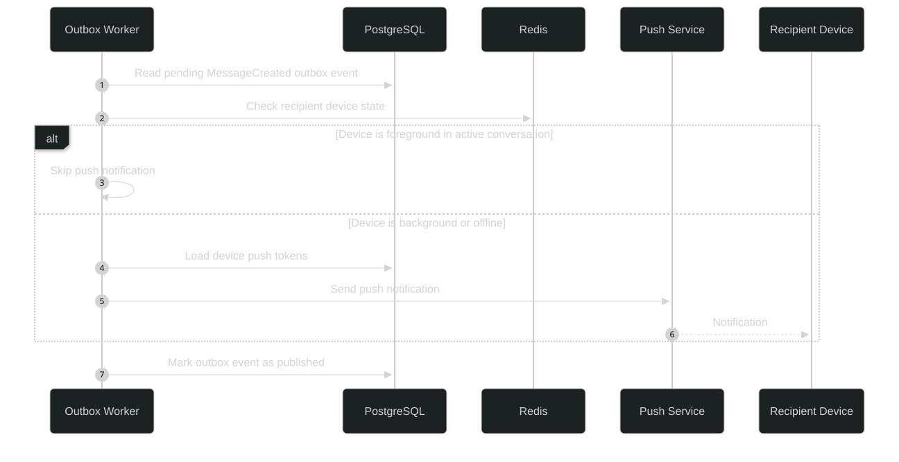

### Description

- Push notification is decided per device, not only per user.

- Device state such as foreground, background, and offline is stored in Redis. Durable push data is stored in `DEVICES`. If the recipient device is background or offline, the worker sends a push notification using `push_token` and `push_provider`.

---

## 15. WebSocket Event Gap Handling

### Diagram

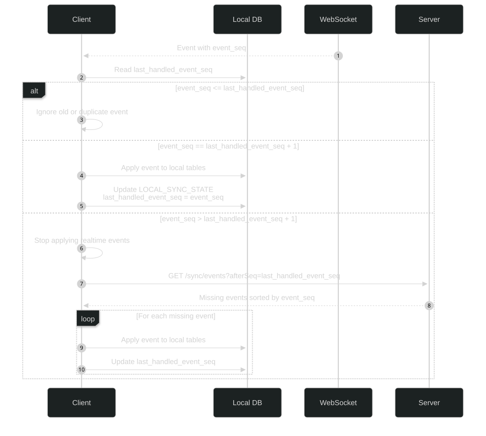

### Description

- This flow runs when the client receives realtime events from WebSocket.

- The client checks `event_seq` before applying an event. If the event is old or duplicated, it is ignored. If the client detects a gap, for example it expects `6` but receives `7`, it stops applying realtime events and calls `/sync/events?afterSeq=last_handled_event_seq`.

- The checkpoint is stored in `LOCAL_SYNC_STATE`. It should only be updated after the event is saved into the local database.

---

## 16. Send Failure and Retry

### Diagram

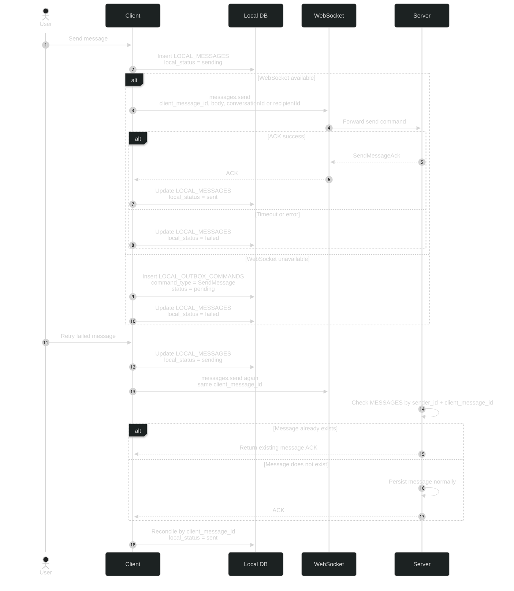

### Description

- This flow handles send timeout, network error, and retry.

- When the user sends a message, the client first inserts a local message with `LOCAL_MESSAGES.local_status = sending`. If sending fails, the client changes it to `failed`.

- Retry must use the same `client_message_id`. The server checks `MESSAGES` by `sender_id` and `client_message_id`. If the message already exists, the server returns the existing message instead of inserting a duplicate.

- Only messages with `LOCAL_MESSAGES.local_status = failed` can be retried or deleted locally.

---

## 17. Device Registration / Push Token Refresh

### Diagram

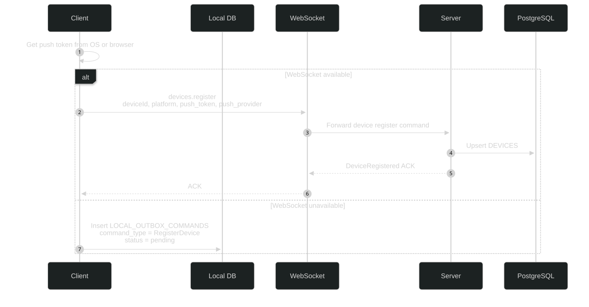

### Description

- This flow runs after login, app open, or push token refresh.

- The client sends `deviceId`, `platform`, `push_token`, and `push_provider` to the server. The server upserts this data into `DEVICES`.

- This data is needed for push notification when a device is offline or in background. If WebSocket is not available, the client stores a `RegisterDevice` command in `LOCAL_OUTBOX_COMMANDS` and sends it later.

---

## 18. Presence and Last Seen

### Diagram

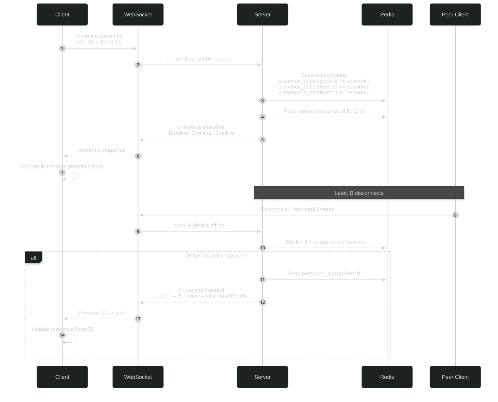

### Description

- Presence state is temporary, so it is stored in Redis and kept in client memory, not in PostgreSQL or local DB.

- When a device connects, the server marks it online in Redis. When the last device of a user disconnects, the server updates `USERS.last_seen_at`.

- The client subscribes to presence for users that are currently visible, such as peers in the loaded conversation list or the opened chat detail. The server returns a presence snapshot and later sends `PresenceChanged` events only to subscribed clients.

- The UI uses `LOCAL_USERS` for avatar, name, and email. It uses the in-memory presence state to show the green online dot or last seen text.

---

## 19. Typing Indicator

### Diagram

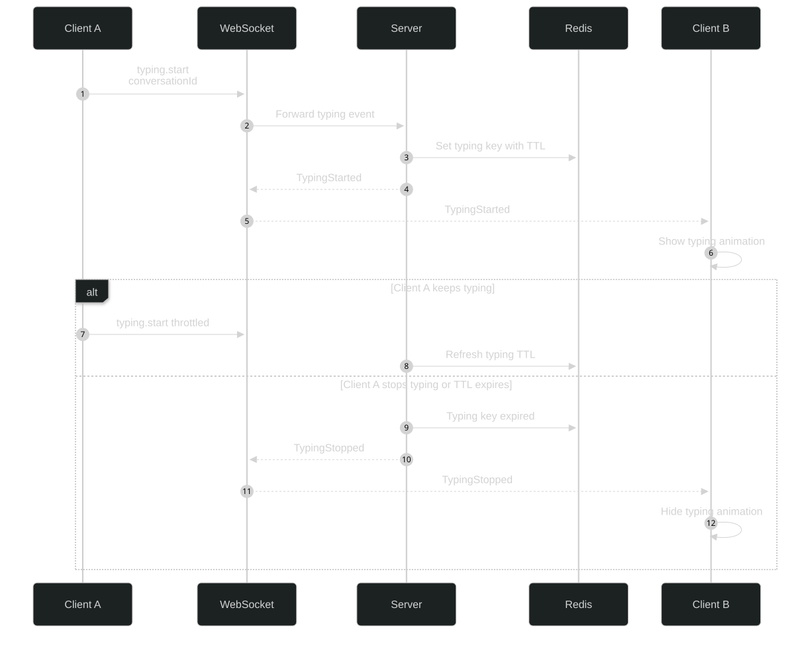

### Description

- Typing is temporary and should not be stored in PostgreSQL or local DB.

- When a user is typing, the client sends `typing.start` through WebSocket. The server stores a typing key in Redis with a short TTL and sends `TypingStarted` to the peer.

- The client should throttle `typing.start`, for example send it every few seconds while the user is typing. When the TTL expires or the user stops typing, the peer receives `TypingStopped`.
